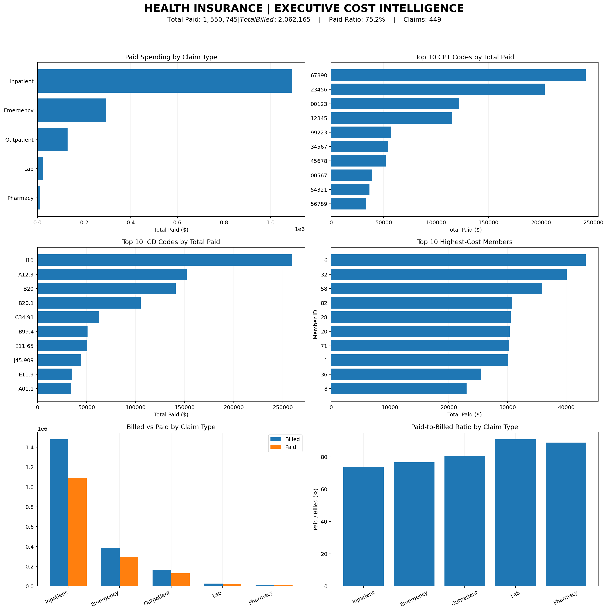

# Health Insurance Claims — Cost & Spending Intelligence

## Executive Overview

This project examines **synthetic health insurance claims**
to identify the services, procedure codes, diagnosis codes,
providers, and members responsible for the highest spending.

The analysis was prepared for a hypothetical insurer's
executive leadership team to help prioritize financial
investigations and operational improvement opportunities.

**Core question:** Where is claims spending concentrated,
and which areas deserve deeper financial and clinical review?

## Executive Dashboard



The dashboard is a static, Python-generated overview built
with Matplotlib. A separate Tableau-ready CSV is included
for future interactive dashboard development.

## Key Performance Indicators

| KPI | Value |
|---|---:|
| Total claims | 449 |
| Members with claims | 100 |
| Providers | 103 |
| Total billed charges | $2,062,165.05 |
| Total insurer payments | $1,550,744.91 |
| Overall paid-to-billed ratio | 75.20% |
| Average paid amount per claim | $3,453.77 |
| Billed minus paid | $511,420.14 |
| Top 10 members' share of payments | 20.63% |
| Claims flagged outside enrollment dates | 266 |

**Important:** Billed-minus-paid is not profit.
The dataset does not include premiums, operating expenses,
or other information required to calculate profitability.

## Business Questions

1. Which types of claims drive the most spending?
2. Which CPT procedure codes are the largest cost drivers?
3. Which ICD diagnosis codes account for the most payments?
4. Which members account for the greatest spending?
5. How do billed and paid amounts compare across services,
   providers, and procedures?

## Datasets

**claims.csv** — 449 claim records containing:

- Claim, member, and provider identifiers
- Claim date and claim type
- CPT procedure code and ICD diagnosis code
- Billed amount and paid amount

**members.csv** — 100 member profiles containing:

- Member identifier and demographic attributes
- Plan type
- Enrollment start date and enrollment end date

The datasets are joined using `member_id`, with multiple
claims allowed per member.

## Methodology

### 1. Import and Validate

- Load both CSV files with pandas.
- Inspect row counts, column types, duplicates, and nulls.
- Join claims to member records using a many-to-one merge.
- Parse claim and enrollment dates.
- Examine zero-paid claims, payments above charges,
  and claims dated outside recorded enrollment periods.

### 2. Calculate Business Metrics

**Total paid:** SUM(paid_amount)

**Total billed:** SUM(billed_amount)

**Paid ratio:** SUM(paid_amount) / SUM(billed_amount)

**Average paid per claim:** Total paid / Claim count

**Member spending share:** Member paid / Portfolio paid

Two ratio types are provided: aggregate paid-to-billed ratio
and the average of individual claim-level ratios. They
answer different questions and should not be confused.

### 3. Rank Cost Drivers

- Rank claim types by total paid.
- Rank CPT and ICD codes by total paid.
- Compare average cost per CPT claim, with a minimum
  of three claims for the displayed high-average list.
- Rank high-cost members and review their service mix.
- Examine provider spending and payment ratios.

## Findings — Claim Type Spending

| Claim type | Claims | Total paid | Paid / billed |
| --- | --- | --- | --- |
| Inpatient | 99 | $1,092,456.00 | 73.9% |
| Emergency | 88 | $294,441.36 | 76.6% |
| Outpatient | 105 | $129,052.75 | 80.3% |
| Lab | 76 | $23,412.35 | 90.8% |
| Pharmacy | 81 | $11,382.45 | 88.8% |

**Main observation:** Inpatient claims account for
**70.45%** of total paid spending despite representing
99 of 449 claims. This is the primary area for cost review.

Emergency claims are the second-largest category.

## Findings — Top 10 CPT Codes

| CPT code | Claims | Total paid | Average paid / claim |
| --- | --- | --- | --- |
| 67890 | 25 | $242,735.00 | $9,709.40 |
| 23456 | 29 | $203,790.75 | $7,027.27 |
| 00123 | 12 | $122,010.00 | $10,167.50 |
| 12345 | 47 | $115,236.90 | $2,451.85 |
| 99223 | 6 | $57,350.00 | $9,558.33 |
| 34567 | 23 | $54,445.00 | $2,367.17 |
| 45678 | 21 | $52,054.20 | $2,478.77 |
| 00567 | 9 | $38,969.00 | $4,329.89 |
| 54321 | 11 | $36,600.00 | $3,327.27 |
| 56789 | 16 | $33,207.00 | $2,075.44 |

CPT `67890` leads total procedure spending at $242,735.
CPT `00123` has a particularly high average paid amount
per claim among codes with at least three claims.

Code identifiers are retained as text to preserve
leading zeros. Their clinical descriptions have not
been independently verified.

## Findings — Top 10 ICD Codes

| ICD code | Claims | Total paid |
| --- | --- | --- |
| I10 | 34 | $259,566.00 |
| A12.3 | 42 | $152,147.00 |
| B20 | 17 | $140,990.00 |
| B20.1 | 13 | $105,210.00 |
| C34.91 | 18 | $62,905.00 |
| B99.4 | 4 | $51,000.00 |
| E11.65 | 11 | $50,512.00 |
| J45.909 | 17 | $44,465.56 |
| E11.9 | 51 | $34,766.00 |
| A01.1 | 3 | $34,260.00 |

ICD `I10` accounts for the highest total paid amount:
$259,566 across 34 claims.

Total spending reflects both frequency and cost per claim.
The highest-spending code is not necessarily the most
expensive code on a per-claim basis.

## Findings — Highest-Cost Members

| Member ID | Claims | Total paid |
| --- | --- | --- |
| 6 | 4 | $43,300.00 |
| 32 | 5 | $40,080.00 |
| 58 | 4 | $35,920.00 |
| 82 | 4 | $30,690.00 |
| 28 | 5 | $30,560.00 |
| 20 | 8 | $30,375.00 |
| 71 | 5 | $30,230.00 |
| 1 | 4 | $30,120.00 |
| 36 | 5 | $25,530.75 |
| 8 | 5 | $23,046.80 |

The ten highest-cost members account for **20.63%**
of insurer payments.

See `member_claim_type_summary.csv` for their service-level
cost breakdown.

High medical spending does not demonstrate unnecessary care.
Any intervention should prioritize clinical appropriateness,
privacy, and member outcomes.

## Findings — Highest-Spending Providers

| Provider ID | Claims | Total paid | Paid / billed |
| --- | --- | --- | --- |
| PRV00002 | 39 | $318,850.00 | 76.6% |
| PRV00001 | 39 | $151,304.40 | 66.2% |
| PRV67890 | 24 | $136,480.00 | 76.6% |
| PRV54321 | 22 | $123,070.00 | 75.1% |
| PRV12345 | 31 | $105,916.60 | 78.8% |

Provider `PRV00002` is the largest observed provider-level
spending contributor, with $318,850 paid.

Provider comparisons require consideration of service mix,
contract terms, claim volume, and patient complexity.

## Billed vs Paid Analysis

Across the portfolio:

- Total billed: $2,062,165.05
- Total paid: $1,550,744.91
- Overall weighted paid ratio: 75.20%
- Billed-minus-paid difference: $511,420.14

Payment ratios vary across claim types.
A lower paid ratio does not automatically indicate favorable
profitability, and a higher ratio does not prove overpayment.

See `claim_type_summary.csv`, `provider_summary.csv`, and
`cpt_summary.csv` for detailed comparisons.

## Data Quality and Limitations

### Enrollment Date Warning

**266 of 449 claims** are dated outside
their members' recorded enrollment periods.

This is a major data-quality or eligibility-definition
issue requiring investigation before making coverage or
payment-compliance conclusions. These records are retained
in the analysis, not labeled fraudulent.

### Additional Limitations

- The data is synthetic and relatively small.
- The source spans November 2022 through November 2024,
  with uneven coverage across months.
- Claims may not represent all incurred services or
  complete reporting periods.
- No premium revenue or administrative costs are included.
- No adjustment for clinical complexity or provider case mix
  has been performed.
- CPT and ICD descriptions were not validated against
  an authoritative clinical code reference.
- High costs or unusual ratios do not by themselves
  establish fraud, waste, or inappropriate treatment.
- No verified savings estimates are presented.

## Prioritized Business Recommendations

A detailed seven-part management action plan is available
in [RECOMMENDATIONS.md](RECOMMENDATIONS.md).

The key priorities are:

1. Review inpatient claims and contracting opportunities.
2. Investigate leading CPT and ICD spending drivers.
3. Evaluate major providers using comparable services.
4. Support appropriate care coordination for high-cost members.
5. Monitor payment ratios and payment accuracy.
6. Investigate the substantial enrollment-date inconsistencies.
7. Track operational improvements alongside quality outcomes.

## Technology and Tools

- **Python:** Core analysis and dashboard creation
- **pandas:** Data loading, joins, aggregations
- **NumPy:** Calculations
- **Matplotlib:** Static executive dashboard
- **Google Colab:** Notebook execution
- **CSV:** Tableau-ready export for optional future work

**Scope note:** This release contains a Python dashboard,
not a completed interactive Tableau workbook.

## Files

```text
Health-Insurance-Claims-Cost-Intelligence/
├── Health_Insurance_Claims_Analysis.ipynb
├── claims.csv
├── members.csv
├── health_claims_tableau_ready.csv
├── claim_type_summary.csv
├── cpt_summary.csv
├── icd_summary.csv
├── member_summary.csv
├── member_claim_type_summary.csv
├── provider_summary.csv
├── monthly_spending.csv
├── executive_claims_dashboard.png
├── RECOMMENDATIONS.md
├── README.md
├── requirements.txt
└── .gitignore
```

## Reproduce the Analysis

1. Clone or download the repository.
2. Install the Python dependencies:

```bash
python -m pip install -r requirements.txt
```

3. Open `Health_Insurance_Claims_Analysis.ipynb` in
   Google Colab or a compatible Jupyter environment.
4. Upload `claims.csv` and `members.csv` into `/content`
   when running in Colab.
5. Run the notebook from top to bottom.
6. Review the validation results, summary tables,
   dashboard image, and recommendations.

The included analysis notebook is designed for Colab.
Local Jupyter users may need to adjust `/content` paths.

## Suggested Future Improvements

- Build an interactive Tableau executive dashboard.
- Add dynamic reporting-period and claim-type filters.
- Verify enrollment and eligibility history.
- Add premium, administrative, and contractual data to
  support real insurer profitability analysis.
- Introduce risk-adjusted provider benchmarking.
- Evaluate clinical and financial outcomes of any
  proposed interventions.

## Conclusion

Inpatient services dominate the observed spending profile,
while specific CPT codes, ICD codes, and providers contribute
substantial additional concentration.

The most urgent data-governance issue is the mismatch between
claim dates and recorded enrollment periods.

This project provides an evidence-based starting point for
leadership review, not proof of avoidable costs or
a production-ready healthcare financial decision system.
